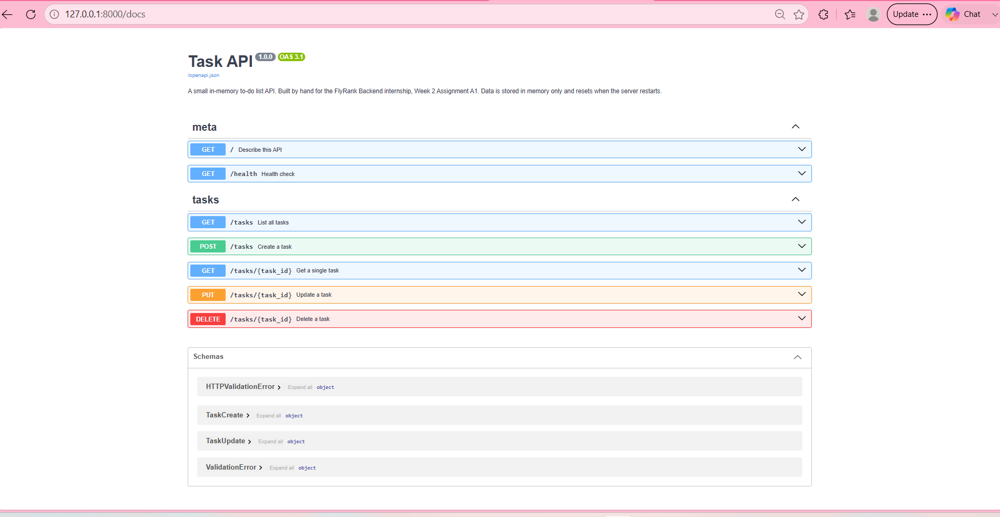

# Task API

A small REST API for managing a to-do list, built with **FastAPI**.

Tasks are stored **in memory**, so the data resets every time the server restarts.
No database is used.

## Endpoints

| Method | Path               | Description                                   | Success |
| ------ | ------------------ | --------------------------------------------- | ------- |
| GET    | `/`                | API info — name, version, available endpoints | 200     |
| GET    | `/health`          | Health check, used by monitoring tools        | 200     |
| GET    | `/tasks`           | List all tasks                                | 200     |
| POST   | `/tasks`           | Create a new task                             | 201     |
| GET    | `/tasks/{task_id}` | Get a single task by id                       | 200     |
| PUT    | `/tasks/{task_id}` | Update a task                                 | 200     |
| DELETE | `/tasks/{task_id}` | Delete a task                                 | 200     |

Invalid input returns **400 Bad Request** (missing or empty title). Malformed bodies, such as a number where text is expected, return **422** (FastAPI's default validation error). An unknown task id returns **404 Not Found**.

## Requirements

- Python 3.10+
- FastAPI
- Uvicorn

## Setup

Create and activate a virtual environment:

```powershell
python -m venv .venv
.\.venv\Scripts\Activate.ps1
```

Install the dependencies:

```powershell
pip install fastapi uvicorn
```

## Run

```powershell
uvicorn main:app --reload
```

Then open:

- Interactive docs: <http://127.0.0.1:8000/docs>
- API root: <http://127.0.0.1:8000/>

## Screenshots

Swagger UI showing all endpoints:



## Example requests

Create a task:

```
curl -i -X POST http://localhost:8000/tasks -H "Content-Type: application/json" -d "{\"title\":\"Buy milk\"}"
```

List all tasks:

```
curl -i http://localhost:8000/tasks
```

## Project structure

```
flyrank-task-api/
├── main.py
├── README.md
├── .gitignore
└── swagger.png
```
